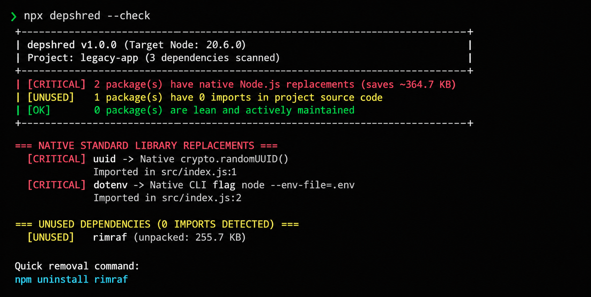

<p align="center">
  
</p>

<h1 align="center">depshred</h1>

<p align="center">
  <em>Clean up your node_modules. Stop installing stuff Node already has.</em>
</p>

<p align="center">
  
  
  
  
</p>

---

Ever look at your `node_modules` folder and wonder why it takes up half your hard drive?

When you follow tutorials or ask AI to write code, it is super easy to end up with 30 different packages installed for things modern Node can already do by itself. Stuff like `dotenv`, `uuid`, or `rimraf` do not need to be in your project anymore. Node already knows how to do all of that.

`depshred` looks through your project, finds packages you do not actually need, and shows you how to swap them for simple code that comes with Node.

---

## Quick start

You do not even need to install anything first. Just open your terminal inside your project folder and run:

```bash
npx depshred
```

If your project lives in another folder, just tell it where:

```bash
npx depshred ./path/to/your-project
```

Using pnpm or bun instead of npm? That works too:

```bash
pnpm dlx depshred
bunx depshred
```

---

## What it looks like

Here is what you see when you run it in your terminal:

<p align="center">
  
</p>

You get an easy list you can move through with your arrow keys:

```text
+--------------------------------------------------------------------------+
| depshred v1.0.0 (Node v20.12.0)                                          |
| Target: ./my-project                                                     |
+--------------------------------------------------------------------------+
| Total Scanned: 24 dependencies                                           |
|                                                                          |
| [CRITICAL] 2 packages have native Node.js replacements (saves ~182 KB)   |
| [UNUSED]   1 package has 0 imports (run: npm uninstall rimraf)           |
| [WARN]     1 package is dormant >3y (0 sub-deps, self-contained)         |
| [OK]       20 packages are lean and actively maintained                  |
+--------------------------------------------------------------------------+

Select a dependency to inspect (Use arrow keys, Enter to inspect):
  > [CRITICAL] dotenv    Native Node.js built-in available (saves ~72 KB)
    [CRITICAL] uuid      Native Node.js built-in available (saves ~110 KB)
    [UNUSED]   rimraf    0 imports found in project source code
    [WARN]     ms        Dormant >3 years | 0 sub-dependencies (self-contained)
    [OK]       fastify   Active, schema-compiled and lean
```

---

## What it checks for

When you run `depshred`, it checks three main things:

1. **Stuff Node already has built in**
Do you really need `dotenv` when Node can load `.env` files on its own? Do you need `uuid` when Node has `crypto.randomUUID()`? `depshred` finds every file and exact line number where you use these, and shows you the quick built-in way to replace them.

2. **Packages you installed but never use**
Ever ran `npm install` for a test or a guide, forgot about it, and left it sitting in your `package.json`? `depshred` scans your whole project. If you never imported it anywhere, it tells you straight up: `npm uninstall <package>`.

3. **Old or abandoned packages**
It checks npm to see how big each package is and whether anyone has touched it in the last 3 years. If a package is small, has zero other packages inside it, and just works, `depshred` lets you know so you do not have to worry.

```text
                    Your package.json
                            |
         +------------------+------------------+
         |                  |                  |
         v                  v                  v
 1. Already in Node?   2. Used in code?   3. npm check
 (dotenv, uuid, etc.)  (0 imports found)  (file size, age)
         |                  |                  |
         v                  v                  v
 Use Node built-ins      Safe to delete    Good to know
 (saves disk space)     (npm uninstall)   (see how big it is)
```

---

## Extra options

Need to run it inside a script or change how it works? Here are the flags you can use:

| Flag | What it does |
| :--- | :--- |
| `--check` | Checks your project and stops with an error if it finds bad or useless packages. Great for GitHub Actions. |
| `--strict` | Like `--check`, but also stops on small warnings. |
| `--json` | Prints results as JSON so you can read them with code. |
| `--no-interactive` | Skips the arrow-key menu and just prints a plain table. |
| `--path <folder>` | Checks a different folder instead of where you are right now. |
| `--dormant-years <num>` | How many years without updates before calling a package old (defaults to 3). |
| `--ignore <names>` | Comma-separated names of packages you want to skip. |
| `--init-skill [app]` | Adds instructions to your AI editor so it stops installing packages you do not need. |
| `--help`, `-h` | Shows all available flags. |
| `--version`, `-v` | Shows the version number. |

---

## Teach your AI editor to stop installing junk

If you use AI coding tools like Cursor, Claude, Windsurf, or GitHub Copilot, you have probably seen them run `npm install` for every single little thing. Most of the time, Node already has what they are trying to download.

You can teach your AI helper to check first before installing:

```bash
# Pick your editor from a menu:
npx depshred --init-skill

# Or pick your editor directly:
npx depshred --init-skill cursor       # For Cursor (.cursor/rules)
npx depshred --init-skill copilot      # For GitHub Copilot (.github)
npx depshred --init-skill windsurf     # For Windsurf (.windsurf/rules)
npx depshred --init-skill claude       # For Claude Code (CLAUDE.md)
npx depshred --init-skill cline        # For Cline (.clinerules)
npx depshred --init-skill antigravity  # For Antigravity (.agents/skills)
npx depshred --init-skill agents       # For general agents (AGENTS.md)
npx depshred --init-skill all          # Sets up all of them at once
```

Want to see all the skill files and how they work? Check out [SKILLS.md](SKILLS.md).

---

## Save your settings

If there is a package you want `depshred` to leave alone, you can save your preferences right inside your `package.json`:

```json
{
  "depshred": {
    "ignore": ["fast-deep-equal"],
    "dormantYears": 4
  }
}
```

---

## What projects work with it?

Pretty much any modern Node.js project:

- **Any framework:** Express, Fastify, Next.js, NestJS, Koa, or plain Node scripts.
- **Any module style:** Both `import` (ES Modules) and `require` (CommonJS).
- **JavaScript and TypeScript:** `.js`, `.ts`, `.jsx`, `.tsx`, `.mjs`, `.cjs`.
- **Projects with multiple folders:** Works with monorepos using the `--path` flag.

---

## Questions you might have

**Does it change my code automatically?**  
No. `depshred` never touches your code behind your back. It shows you the file, the line number, and the built-in Node replacement. You decide what to change and when.

**Does it need a database or send my code to some server?**  
No. Everything runs right on your computer. It only talks to the public npm website to check package sizes and update dates. It saves that info in your computer's temporary folder for a day so it stays fast.

**What if an old package works fine and does not need updates?**  
Not every old package is broken. Some small tools are simply finished and do not need changes. `depshred` checks if the package has zero sub-packages. If it is small and self-contained, it gives you a soft heads-up, not a red error. You can also add it to your ignore list.

**Does it work with Python or Go?**  
No, this is built only for Node.js and npm projects.

---

## License

[MIT](LICENSE).